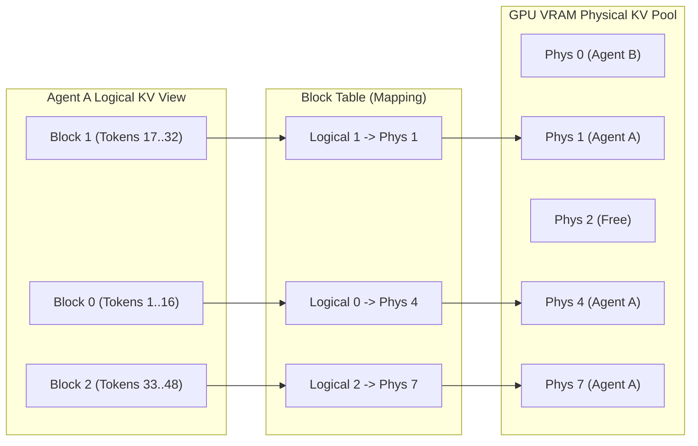
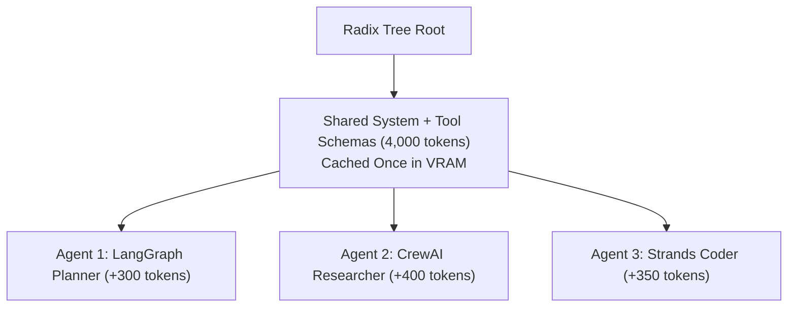
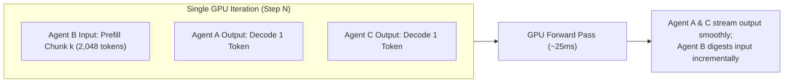
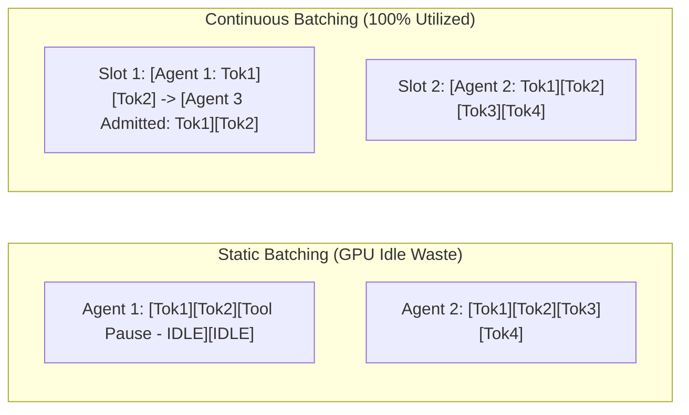
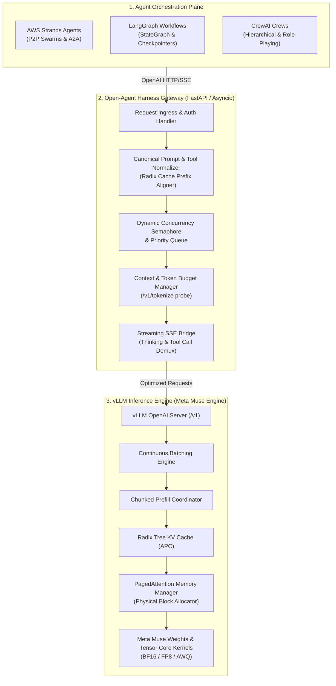
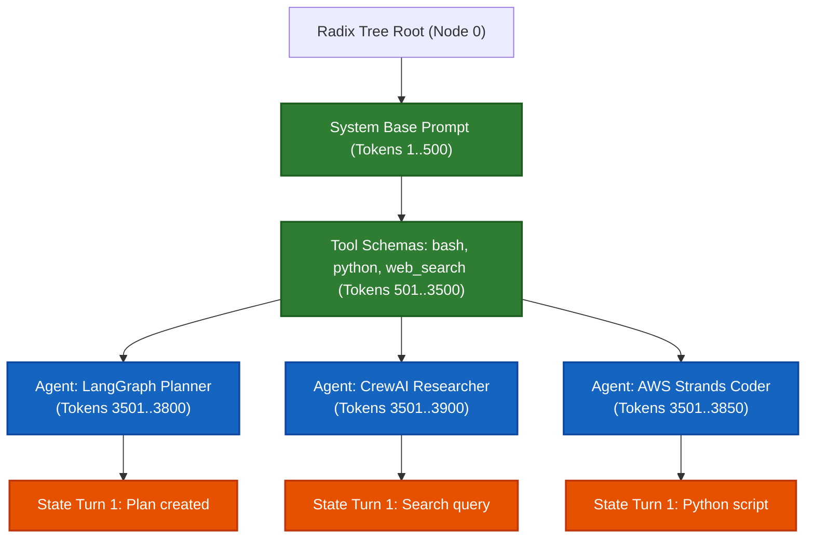
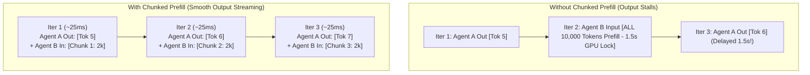
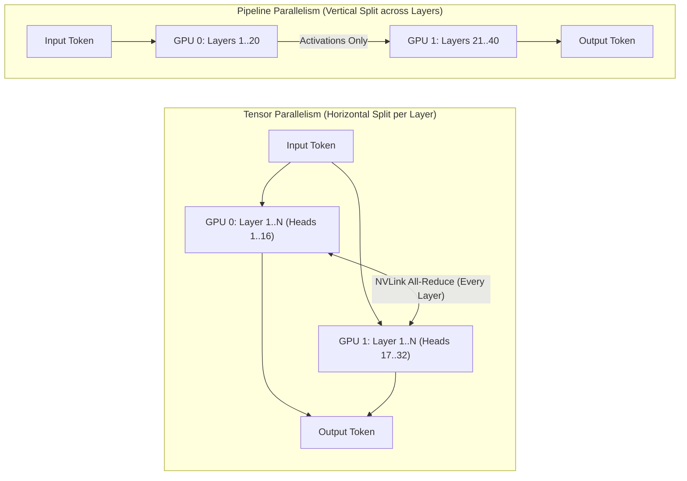
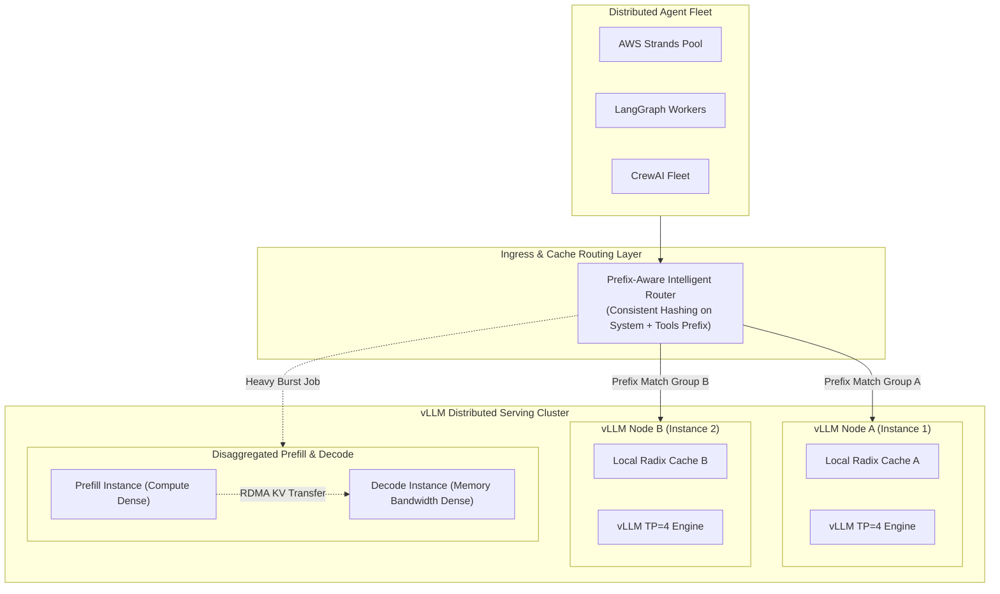

# Engineering Design Document: Distributed Agent Architecture on vLLM Harness
**Document ID:** RFC-2026-OAH-001  
**Status:** PROPOSED / DRAFT  
**Author:** AI Systems Architecture Team  
**Target System:** Open-Agent-Harness  
**Primary Engine:** vLLM (OpenAI-Compatible Serving)  
**Primary Model:** Meta Muse (`meta-models/Muse-Glimmer-30B`)  
**Supported Frameworks:** AWS Strands Agents, LangGraph, CrewAI  

---

## 1. Executive Summary

Autonomous agentic workflows (multi-agent swarms, hierarchical teams, cyclic graph workflows) generate an inference profile fundamentally distinct from standard conversational LLM applications. Agents repeatedly invoke models in iterative tool-calling loops, sharing massive system instructions, broad tool schema catalogs, task specifications, and multi-turn state.

Deploying distributed agent frameworks (specifically **AWS Strands**, **LangGraph**, and **CrewAI**) against unoptimized local inference engines rapidly encounters severe bottlenecks:
* **KV Cache Thrashing:** Because multiple concurrent agents hold long, growing contexts in GPU memory (VRAM) simultaneously, unpaged or unshared KV caches quickly exhaust VRAM. The engine is forced to repeatedly evict active request states and recompute identical prompt prefixes (system prompts, tool schemas) from scratch.
* **Prefill Latency Spikes (TTFT Starvation):** When an agent receives a large tool output (e.g., a 15,000-token file read or web scrape), a standard engine processes all input tokens in one monolithic, compute-bound pass. This monopolizes the GPU, spiking Time-To-First-Token (TTFT) and freezing output token generation for every other active agent.
* **GPU Out-of-Memory (OOM) Failures:** Contiguous memory pre-allocation for worst-case context lengths fragments VRAM and starves concurrency.

This document specifies the end-to-end design of an enterprise-grade agent harness that couples distributed agent orchestrators with **vLLM**. By exploiting four core vLLM primitives—**PagedAttention** (OS-style virtual memory paging for KV cache), **Automatic Prefix Caching (APC)** (Radix-tree reuse of shared prompt prefixes), **Chunked Prefill** (splitting large input prefills so they interleave with output token decoding), and **Continuous Batching** (iteration-level scheduling that swaps requests in and out on every token step)—this architecture achieves up to an **85–95% KV cache reuse rate**, slashes TTFT by up to **80%**, and doubles concurrent agent density on GPU hardware.

The design is phased:
1. **Phase 1 (Single-Node Baseline):** A unified host running an OpenAI-compatible vLLM engine serving Meta Muse (specifically `Muse-Glimmer-30B`), paired with an Open-Agent-Harness Gateway that normalizes agent prompts for maximal cache hits and manages concurrency.
2. **Phase 2 (Scale-Up / Multi-GPU):** Intra-node **Tensor Parallelism (TP)** (splitting each transformer layer horizontally across GPUs over high-speed NVLink) and **Pipeline Parallelism (PP)** (splitting consecutive transformer layers vertically into stages across GPUs).
3. **Phase 3 (Scale-Out / Distributed Multi-Instance):** Multi-node cluster with **Prefix-Aware Routing**, **Disaggregated Prefill and Decode (Split P/D)**, and distributed agent worker pools.

---

## 2. Problem Statement & Motivation

### 2.1 The Agentic Inference Bottleneck
Traditional chatbots process a linear sequence of user prompts and model responses. In contrast, multi-agent architectures exhibit:
1. **Redundant Prefix Repetition (Causes KV Cache Thrashing):** In a 4-agent CrewAI or LangGraph workflow (e.g., Planner, Researcher, Coder, Critic), all agents often share 2,000 to 10,000 tokens of identical tool schemas, environment definitions, and system prompts on every single turn. Without prefix sharing, each agent stores its own duplicate copy of those KV tensors in VRAM. As concurrent agents grow, total KV memory exceeds GPU capacity, forcing the engine into **KV cache thrashing**—constantly evicting active KV states to CPU/discarding them, then recomputing the exact same prompt prefixes on the next turn.
2. **Burst Concurrency & Huge Tool Outputs (Causes Prefill Latency Spikes):** Frameworks like CrewAI's hierarchical delegator or AWS Strands' parallel swarms dispatch multiple agent LLM calls concurrently, and tool calls frequently inject 10,000–15,000+ tokens (e.g., file reads, logs, search results) into the prompt. In standard engines, processing that massive *input* prompt (prefill) monopolizes the GPU's tensor cores in a single uninterrupted pass, causing **prefill latency spikes** that freeze *output* token streaming for every other active agent.
3. **High Turn Count & Fluctuating Context:** Reasoning models like Meta Muse emit extensive chain-of-thought tokens (`<thinking>` / `reasoning_content`) before executing tools. The context window rapidly expands to tens of thousands of tokens, causing severe virtual memory fragmentation if allocated contiguously.
4. **Heterogeneous Orchestration Paradigms:**
   - **AWS Strands:** Event-driven, local-first agent swarms with peer-to-peer agent-to-agent (A2A) message passing.
   - **LangGraph:** Graph-based state machine with explicit branching, conditional checkpoints, and cyclical execution loops.
   - **CrewAI:** Role-playing hierarchical task delegators where manager agents orchestrate subordinate worker agents.

### 2.2 Why vLLM as the Unified Substrate
vLLM provides four critical architectural primitives that neutralize these agentic bottlenecks. Below is how each mechanism works conceptually:

#### 1. PagedAttention (Virtual Memory for KV Cache)
Instead of pre-allocating a giant contiguous VRAM buffer per request, vLLM splits each agent's KV cache into fixed-size **16-token logical blocks** and maps them via a **Block Table** to arbitrary, non-contiguous **physical VRAM blocks** allocated on demand (see Section 5.1 for full memory math).



#### 2. Automatic Prefix Caching (APC via Radix Trees)
vLLM indexes physical KV blocks in a **Radix Tree** (prefix tree). When multiple agents share the same system prompt and tool schemas, they point to the *exact same* physical KV blocks in VRAM—skipping prefill computation for the shared prefix and computing only the new delta tokens.



#### 3. Chunked Prefill (Interleaving Input Prefill with Output Decoding)
**Clarification on Input vs. Output:** *Prefill* processes the **input** prompt tokens (compute-bound); *Token Decoding* generates the **output** tokens one-by-one (memory-bandwidth-bound). Without Chunked Prefill, a 15k-token input tool output from Agent B blocks the GPU, stalling Agent A's output stream. With Chunked Prefill, vLLM slices Agent B's input into small chunks (e.g., 2,048 tokens) and packs **1 chunk of Agent B's input + 1 output decode token for Agent A** into the *same* GPU forward pass (see Section 5.3 for the iteration timeline).



#### 4. Continuous (Iteration-Level) Batching
Static batching forces all requests in a batch to wait until the slowest agent finishes generating before admitting new requests—leaving GPU slots idle whenever an agent pauses to execute a Python/bash tool. Continuous batching schedules at the **token-iteration level**: the instant an agent emits a tool call or finishes, its slot is freed and a waiting agent turn is admitted on the very next token step.



---

## 3. Goals & Non-Goals

### 3.1 In-Scope (Goals)
* **Unified OpenAI Gateway:** Expose an OpenAI-compliant streaming endpoint (`/v1/chat/completions`) capable of seamlessly servicing AWS Strands, LangGraph, and CrewAI simultaneously.
* **Deterministic Prefix Alignment:** Establish a canonical prompt structuring engine inside the harness to guarantee maximum Radix Tree cache hits across diverse agent frameworks.
* **Support for Meta Muse:** Full native compatibility with Meta Muse models (e.g. `meta-models/Muse-Glimmer-30B`), including live streaming of `reasoning_content` (thinking tokens) and structured tool calling.
* **Single-Node Optimization (Phase 1):** Optimal memory allocation between model weights, KV cache, and agent execution runtimes on a single host.
* **Multi-GPU / Distributed Roadmap (Phase 2 & 3):** Architectural blueprint for Tensor Parallelism, Prefix-Aware Routing, and Disaggregated Prefill/Decode.
* **Context Compaction & Token Budgeting:** Tight coordination between the harness context manager and vLLM's `/v1/tokenize` probe to prevent context overflow before hitting engine limits.

### 3.2 Out-of-Scope (Non-Goals)
* Proprietary fine-tuning or modifying vLLM CUDA kernels directly.
* Writing a new agent orchestration framework from scratch (the goal is to harness AWS Strands, LangGraph, and CrewAI).
* Multi-datacenter geo-replication (focus is on local node to single-VPC cluster).

---

## 4. Architectural Overview & System Topology

The system is structured into three clean planes:
1. **Agent Orchestration Plane (Client Runtimes):** Houses distributed agent processes running AWS Strands, LangGraph, and CrewAI.
2. **Open-Agent Harness Gateway (Mediation & Optimization Plane):** Middleware responsible for prompt canonicalization, token budgeting, concurrency queueing, and telemetry.
3. **vLLM Inference Plane (Execution Substrate):** The GPU engine hosting Meta Muse with PagedAttention and Radix Caching.



---

## 5. Detailed Engine Design: Leveraging vLLM Efficiencies

### 5.1 Memory Management & PagedAttention
During autoregressive generation, an LLM caches the **Key (K)** and **Value (V)** attention tensors for every processed token across all transformer layers so it does not have to recompute the entire conversation history on every newly generated token. For a 30B model like Meta Muse with a 131,072-token context window, a single request's full KV cache can consume tens of gigabytes of VRAM.

Standard inference servers pre-allocate a **single contiguous VRAM buffer** sized to `max_model_len` (131,072 tokens) the moment a request arrives, creating two severe fragmentation problems:
* **Internal Fragmentation:** An agent starting a task may only use 2,500 tokens—or peak at 12,000 tokens—yet the engine reserves VRAM for all 131,072 tokens. Over **80–95% of that reserved memory sits empty** and unusable by other agents.
* **External Fragmentation:** As variable-length agent requests complete, they leave scattered, non-contiguous "holes" in VRAM that cannot fit new large contiguous allocations.

**How PagedAttention Solves This:**
Inspired by virtual memory paging in operating systems, PagedAttention decouples an agent's **logical token sequence** from **physical GPU memory**:
1. **Fixed-Size KV Blocks:** VRAM is partitioned into small, uniform physical blocks (configured via `--block-size 16`, storing 16 tokens per block).
2. **Logical-to-Physical Block Table:** Each agent maintains a lightweight Block Table mapping logical block indices (`0, 1, 2...`) to arbitrary, non-contiguous physical blocks in VRAM.
3. **On-Demand Allocation & Immediate Reclamation:** When an agent starts, vLLM allocates *only* the physical blocks needed for its current prompt (e.g., 125 blocks for 2,000 tokens). New blocks are appended one by one only as the agent generates tokens or receives tool results, and are freed immediately upon completion or context compaction.
4. **Zero-Copy Prefix Sharing & Copy-on-Write (CoW):** Because blocks are addressed by pointer, multiple agents sharing an identical system prompt or tool schema map their logical blocks `0..N` to the *exact same physical VRAM blocks*. Only when an agent diverges (e.g., appends its own role or tool output) are new physical blocks allocated.
* **Benefit:** Memory waste drops from 70–85% down to **< 4%** (only the partially filled final block), allowing concurrency to scale from 2 to 12+ parallel agent streams on a single GPU.

### 5.2 Automatic Prefix Caching (APC) & Radix Trees for Agent Prompts
Agentic frameworks typically structure prompts with:
1. System instructions (e.g. general agent policies, constraints)
2. Tool JSON declarations (`tools` parameter)
3. Agent identity / role definition
4. Task objective
5. Multi-turn chat / tool history

vLLM's APC maintains a **Radix Tree** (trie) over physical KV blocks. When an agent submits a prompt:
* vLLM traverses the Radix tree to find the longest matching prefix of cached tokens.
* If 4,000 tokens of system prompts and tool schemas match an existing branch, those 4,000 tokens are **not computed**. Their pre-computed KV tensors are referenced directly via pointer increments in the block table.
* Only the novel tokens (e.g. latest tool response or agent thoughts) execute the compute-heavy prefill phase.



> **Prefix Cache Hit Rate Target:** $\ge 85\%$ across all agent framework requests.  
> **TTFT Reduction:** From ~3,200 ms to $< 250\text{ ms}$ for a 4k prefix on Meta Muse Glimmer.

### 5.3 Chunked Prefill & Continuous Batching
To understand Chunked Prefill, it helps to separate the two phases of LLM inference:
* **Prefill (Processing the Input):** Computing KV tensors for all *input* prompt tokens in parallel before the first output token can be emitted. This phase is **compute-bound**.
* **Token Decoding (Generating the Output):** Producing *output* tokens autoregressively, one token per GPU forward pass (iteration). This phase is **memory-bandwidth-bound** and directly governs streaming speed (Inter-Token Latency, or ITL).

**Yes—the interleaving directly protects LLM output streaming.** In multi-agent loops, an agent executing a web scrape or file search may return a 10,000-token tool output as its next *input* prompt:
* **Without Chunked Prefill:** The vLLM scheduler dedicates the GPU entirely to prefilling Agent B's 10,000 *input* tokens in one giant pass. All other agents currently streaming *output* tokens (Agent A, Agent C) are frozen until Agent B finishes prefilling, causing severe ITL stutter.
* **With Chunked Prefill (`--enable-chunked-prefill`):**
  - vLLM caps the total tokens processed per GPU iteration via `--max-num-batched-tokens 2048` (or `4096`).
  - Agent B's 10,000-token *input* is sliced into ~2,000-token chunks across five consecutive GPU iterations.
  - In **every single iteration**, vLLM packs **1 output decode token for each streaming agent** (e.g., Agent A's next output token) together with **1 input prefill chunk from Agent B** into the same forward pass.
  - **Outcome:** Agent A's output stream never stalls; it continues emitting tokens every ~20–30 ms while Agent B's large tool output is digested incrementally.



---

## 6. Open-Agent Harness Gateway: Prompt Alignment Engine

If agent frameworks format their prompts arbitrarily, prefix caching fails. For example, if Framework A places tool schemas before system prompts, and Framework B places system prompts before tool schemas, vLLM will branch two separate Radix paths, cutting cache efficiency in half.

The Harness Gateway introduces a **Canonical Prompt & Tool Normalizer**.

### 6.1 Canonical Prefix Structure
The Gateway enforces a strict token sequence across all incoming requests from AWS Strands, LangGraph, and CrewAI:

$$\text{Canonical Request} = [\text{Header}] \parallel [\mathcal{T}_{\text{sorted}}] \parallel [\mathcal{S}_{\text{global}}] \parallel [\mathcal{P}_{\text{agent}}] \parallel [\mathcal{C}_{\text{task}}] \parallel [\mathcal{H}_{\text{history}}]$$

Where:
1. **$\text{Header}$:** Immutable system prologue.
2. **$\mathcal{T}_{\text{sorted}}$:** JSON schemas of all active tools, sorted alphabetically by `function.name` with whitespace stripped and keys canonicalized.
3. **$\mathcal{S}_{\text{global}}$:** Shared workspace policies, environment constraints, and global instructions.
4. **$\mathcal{P}_{\text{agent}}$:** Framework-specific agent persona (e.g., "Role: Senior Systems Architect").
5. **$\mathcal{C}_{\text{task}}$:** The root user prompt / overarching objective.
6. **$\mathcal{H}_{\text{history}}$:** The evolving conversation history and tool execution returns.

### 6.2 Tool Declaration Canonicalization Algorithm
```python
def canonicalize_tools(tools: list[dict]) -> list[dict]:
    """
    Ensures identical JSON serialization for tool lists regardless of
    how the agent framework presents them. Guarantees prefix cache hits.
    """
    if not tools:
        return []
    # Sort tools alphabetically by function name
    sorted_tools = sorted(tools, key=lambda t: t.get("function", {}).get("name", ""))
    
    # Deeply canonicalize dict keys and json representations
    canonical_tools = []
    for tool in sorted_tools:
        fn = tool.get("function", {})
        cleaned_tool = {
            "type": "function",
            "function": {
                "name": fn.get("name"),
                "description": fn.get("description", "").strip(),
                "parameters": fn.get("parameters", {})
            }
        }
        canonical_tools.append(cleaned_tool)
    return canonical_tools
```

---

## 7. Multi-Agent Framework Integration Layer

Each agent framework communicates with the Open-Agent Harness Gateway through its standard OpenAI-compatible client interface, requiring zero modifications to the framework cores.

### 7.1 AWS Strands Integration
AWS Strands connects models via provider classes. We configure Strands using an `OpenAIModel` provider pointing to the harness gateway:

```python
from strands_agents import Agent, Runner
from strands_agents.models import OpenAIModel

# Configure AWS Strands to point to the local Harness Gateway
vllm_model = OpenAIModel(
    model_id="meta-models/Muse-Glimmer-30B",
    client_args={
        "base_url": "http://localhost:8000/v1",
        "api_key": "not-needed"
    },
    params={
        "temperature": 0.2,
        "max_tokens": 4096,
        "extra_body": {
            "enable_thinking": True,
            "thinking_mode": "medium"
        }
    }
)

# Instantiate a Strands Agent
worker_strand = Agent(
    name="DevOpsEngineer",
    model=vllm_model,
    system_prompt="You are a DevOps automation agent. Diagnose and remediate infrastructure.",
    tools=[bash_tool, docker_tool]
)
```

### 7.2 LangGraph Integration
LangGraph workflows use `ChatOpenAI` from `langchain_openai`. We preserve Radix prefix stability across state transitions by pinning tool definitions and using structured state:

```python
from langchain_openai import ChatOpenAI
from langgraph.graph import StateGraph, MessagesState, START, END
from langgraph.prebuilt import ToolNode

# ChatOpenAI configured for vLLM harness
llm = ChatOpenAI(
    model="meta-models/Muse-Glimmer-30B",
    base_url="http://localhost:8000/v1",
    api_key="not-needed",
    streaming=True,
    model_kwargs={
        "extra_body": {"enable_thinking": True}
    }
).bind_tools([search_tool, python_repl_tool])

def agent_node(state: MessagesState):
    response = llm.invoke(state["messages"])
    return {"messages": [response]}

# Compile LangGraph workflow
workflow = StateGraph(MessagesState)
workflow.add_node("agent", agent_node)
workflow.add_node("tools", ToolNode([search_tool, python_repl_tool]))
workflow.add_edge(START, "agent")
workflow.add_conditional_edges("agent", should_continue, ["tools", END])
workflow.add_edge("tools", "agent")
app = workflow.compile()
```

### 7.3 CrewAI Integration
CrewAI manages hierarchical or sequential execution across specialized agent personas. We configure CrewAI's `LLM` class to leverage the harness gateway:

```python
from crewai import Agent, Crew, Process, Task, LLM

# Configure CrewAI's native LLM wrapper for vLLM
harness_llm = LLM(
    model="openai/meta-models/Muse-Glimmer-30B",
    base_url="http://localhost:8000/v1",
    api_key="not-needed",
    temperature=0.3
)

researcher = Agent(
    role="Principal Research Analyst",
    goal="Extract deep architectural patterns from the codebase",
    backstory="You are an elite code auditor with 15 years experience.",
    tools=[file_reader_tool, ripgrep_tool],
    llm=harness_llm,
    verbose=True
)

architect = Agent(
    role="Chief Software Architect",
    goal="Synthesize research into production system designs",
    backstory="You design fault-tolerant distributed systems.",
    llm=harness_llm,
    verbose=True
)

crew = Crew(
    agents=[researcher, architect],
    tasks=[research_task, design_task],
    process=Process.hierarchical,
    manager_llm=harness_llm
)
```

---

## 8. Phase 1: Single-Node Host Architecture (Meta Muse Model)

### 8.1 Hardware Sizing & Memory Layout
Phase 1 focuses on deploying the entire stack on a single high-performance GPU workstation or cloud instance (e.g., AWS `g6e.4xlarge`, `g5.12xlarge`, or `p4d.24xlarge` / on-premise 1x RTX 4090 / A6000 / A100 / H100).

**Model Profile: `meta-models/Muse-Glimmer-30B`**
- Parameters: 30 Billion
- Native Context Window: 131,072 tokens
- Precision: AWQ (4-bit weights) or FP8 (8-bit weights) or BF16

**VRAM Allocation Budget (Example: 80GB NVIDIA A100 / H100)**:
* **Model Weights (AWQ ~18 GB / FP8 ~32 GB / BF16 ~60 GB):** Allocate 32 GB for FP8.
* **vLLM Working Overhead & CUDA Kernels:** ~4 GB.
* **PagedAttention KV Cache Pool:** ~40 GB.
  - At FP8 KV Cache (`--kv-cache-dtype fp8`), 40 GB provides storage for **~650,000 active KV tokens**.
  - This allows **10 concurrent agents** running an average context of 65k tokens, or **30 concurrent agents** with an average context of 20k tokens.
* **Host RAM Allocation (System):**
  - Minimum 64 GB system RAM for host OS, Python agent runtimes, and local disk buffers.

### 8.2 Production vLLM Service Launch Configuration
The single-node vLLM daemon is launched with fine-tuned flags to activate all memory, caching, and reasoning capabilities:

```bash
#!/usr/bin/env bash
# run_vllm_single_node.sh

export VLLM_WORKER_MULTIPROC_METHOD=spawn
export CUDA_VISIBLE_DEVICES=0

vllm serve meta-models/Muse-Glimmer-30B \
  --host 0.0.0.0 \
  --port 8000 \
  --dtype bfloat16 \
  --quantization fp8 \
  --kv-cache-dtype fp8 \
  --max-model-len 65536 \
  --gpu-memory-utilization 0.90 \
  --block-size 16 \
  --enable-prefix-caching \
  --enable-chunked-prefill \
  --max-num-batched-tokens 2048 \
  --max-num-seqs 64 \
  --enable-reasoning \
  --reasoning-parser muse_glimmer \
  --enable-auto-tool-choice \
  --tool-call-parser pythonic \
  --api-key "not-needed"
```

### 8.3 Launch Parameters Breakdown

| Configuration Parameter | Value | Architectural Justification |
|---|---|---|
| `--enable-prefix-caching` | True | Enables Radix Tree KV cache reuse across multi-agent turns. |
| `--enable-chunked-prefill` | True | Prevents large tool outputs from blocking active token generation. |
| `--max-num-batched-tokens`| `2048` | Caps prefill chunks to maintain smooth $\le 30\text{ ms}$ Inter-Token Latency. |
| `--kv-cache-dtype` | `fp8` | Halves KV cache memory per token, doubling agent capacity in VRAM. |
| `--gpu-memory-utilization`| `0.90` | Reserves 90% of GPU VRAM for model weights and dynamic KV cache. |
| `--block-size` | `16` | 16-token paging blocks maximize Radix tree prefix matching granularity. |
| `--reasoning-parser` | `muse_glimmer` | Directs model thinking tokens to `delta.reasoning_content` SSE stream. |

---

## 9. Evolution: Scaling to Multi-GPU & Distributed Instances

As agent workloads grow from a single development machine to production clusters running hundreds of concurrent agent swarms, the architecture transitions through two expansion phases.

### 9.1 Phase 2: Intra-Node Multi-GPU Scale-Up
When running larger Muse variants (e.g., Muse-Spark 70B+) or scaling concurrent agents beyond a single GPU, intra-node parallelism splits the model across multiple GPUs on the same host using two complementary strategies:

1. **Tensor Parallelism (TP across NVLink):**
   - **How it works:** Splits *every individual transformer layer* (attention heads and MLP weight matrices) **horizontally** across GPUs (e.g., `--tensor-parallel-size 4` or `8`). Every GPU computes a slice of the same token in parallel, then synchronizes partial results via an `all-reduce` collective at each layer.
   - **Why NVLink matters:** Because `all-reduce` runs twice per transformer layer (dozens of times per generated token), TP requires ultra-low-latency, high-bandwidth GPU-to-GPU interconnects like **NVLink** (up to 900 GB/s on H100) rather than standard PCIe.
   - **Best for:** Reducing single-request token latency (ITL) and pooling VRAM (e.g., 8x 80 GB = 640 GB) to support 131,072-token contexts across dozens of concurrent agents.

2. **Pipeline Parallelism (PP):**
   - **How it works:** Splits the model **vertically** by assigning consecutive groups of transformer layers to different GPUs (e.g., Layers 1–20 on GPU 0, Layers 21–40 on GPU 1; configured via `--pipeline-parallel-size`). Only the intermediate activation tensor at layer boundaries is passed from GPU 0 to GPU 1.
   - **Why & When to use it:** Requires far less inter-GPU bandwidth than TP, making it viable over slower PCIe links or across nodes. However, sequential execution introduces "pipeline bubbles" (idle time while waiting for earlier stages), so it increases throughput via micro-batching rather than reducing single-request latency.



3. **Ray-Backed Worker Placement:**
   - vLLM utilizes Ray under the hood for multi-GPU process management (`--distributed-executor-backend ray`).
   - The Open-Agent-Harness orchestrates agent runtime processes on CPU cores while pinning inference execution to the GPU cluster.

### 9.2 Phase 3: Distributed Multi-Instance Architecture (Scale-Out)
In Phase 3, the inference cluster scales across multiple physical nodes.



#### 9.2.1 Prefix-Aware Cache Routing
In a standard round-robin multi-node load balancer, Agent Turn 1 goes to Node A (caching the 5k-token prefix), and Agent Turn 2 goes to Node B (resulting in a cache miss and re-prefill).
* **Design Solution:** The Gateway Router computes a fast 64-bit hash (xxHash / MurmurHash3) of the canonicalized prefix $[\text{System Prompt} \parallel \text{Tool Schemas}]$.
* Requests with identical prefix hashes are consistently routed to the same vLLM node via **rendezvous hashing**.
* Cache hit rate across the distributed cluster remains $> 80\%$.

#### 9.2.2 Disaggregated Prefill & Decode (Split P/D)
Agent loops alternate between massive input prefills (reading docs, logs, large code files) and short token generations (deciding the next tool call).
* **Prefill Nodes:** Optimized for high FLOPS (e.g. NVIDIA H100 with high batch tokens). Prefills the prompt and writes KV tensors to a shared memory pool.
* **Decode Nodes:** Optimized for high memory bandwidth. Streams generation tokens with low ITL.
* **KV-Transfer Interconnect:** KV cache blocks are transferred from Prefill nodes to Decode nodes over high-speed InfiniBand / RoCE RDMA using vLLM's distributed KV cache connectors.

---

## 10. Reliability, Observability & SLO Targets

### 10.1 Key Metrics & Prometheus Telemetry
vLLM exposes native Prometheus metrics at `/metrics`. The Harness Gateway enriches these with agent metadata:

| Metric | Target SLO | Description & Alert Condition |
|---|---|---|
| `vllm:gpu_cache_usage_factor` | $0.65 - 0.85$ | Percentage of allocated KV cache in use. Alert if $> 0.95$ (risk of preemption). |
| `vllm:prefix_cache_hit_rate` | $\ge 80\%$ | Ratio of prompt tokens serviced from Radix cache without prefill computation. |
| `vllm:time_to_first_token_seconds` (TTFT) | $\le 300\text{ ms}$ (cached)<br/>$\le 2.0\text{ s}$ (uncached) | Latency until model begins emitting thought/response tokens. |
| `vllm:time_per_output_token_seconds` (ITL) | $\le 25\text{ ms}$ | Token generation speed (streaming fluidness). Alert if $> 45\text{ ms}$. |
| `vllm:num_requests_waiting` | $\le 5$ | Queued requests waiting for GPU allocation. Spike indicates need to scale instances. |

### 10.2 Context Compaction Coordination
To prevent agents from exceeding the `CTX_SIZE` (131,072 tokens) and causing engine-level request rejection:
* The Harness Gateway tracks token accumulation using vLLM's exact `/v1/tokenize` endpoint.
* When context utilization crosses **80%** (`CTX_COMPRESS_THRESHOLD = 0.80`), the harness intercepts the agent loop.
* It executes an out-of-band summarization pass on historical messages, replacing them with a concise architectural summary, and transparently resumes the agent loop without losing active task state.

---

## 11. Security, Sandboxing & Tool Isolation

When distributed agents run with local model execution, safety and isolation must be enforced at the boundary:
1. **Network Separation:** The vLLM server binds strictly to an internal loopback interface (`127.0.0.1`) or a private VPC subnet; never exposed to the public internet without an authenticated ingress proxy.
2. **Tool Execution Sandboxing:** Agents (especially AWS Strands and LangGraph running code execution tools) execute actions inside ephemeral Docker containers or gVisor sandboxes, preventing unauthorized filesystem or network access to the host GPU machine.
3. **Loop Detection & Token Exhaustion Guard:** The Harness Gateway enforces a maximum iterations limit (e.g., `MAX_TURNS = 25`) per agent task to protect against infinite recursion loops.

---

## 12. Implementation Roadmap & Milestones

1. **Milestone 1: Single-Node vLLM + Meta Muse Setup**
   - Benchmark vLLM with `Muse-Glimmer-30B` on a single GPU.
   - Validate PagedAttention, APC, and reasoning parser (`delta.reasoning_content`).
2. **Milestone 2: Gateway Adapter & Prompt Canonicalizer**
   - Implement Canonical Prefix & Tool Normalizer in Open-Agent-Harness.
   - Integrate `/v1/tokenize` probe and context compaction trigger.
   - Verify $\ge 85\%$ Radix cache hit rate on repeated tool turns.
3. **Milestone 3: Framework Validation (Strands, LangGraph, CrewAI)**
   - Build reference test harnesses for AWS Strands, LangGraph, and CrewAI.
   - Execute multi-agent benchmarks measuring TTFT, ITL, and concurrency limits.
4. **Milestone 4: Scale-Up & Scale-Out (Multi-GPU / Distributed)**
   - Enable Tensor Parallelism (`--tensor-parallel-size`) on multi-GPU instances.
   - Deploy Prefix-Aware Load Balancer across multi-node cluster.
   - Instrument Prometheus/Grafana dashboards and operational alerting.

---
*End of Design Document.*
